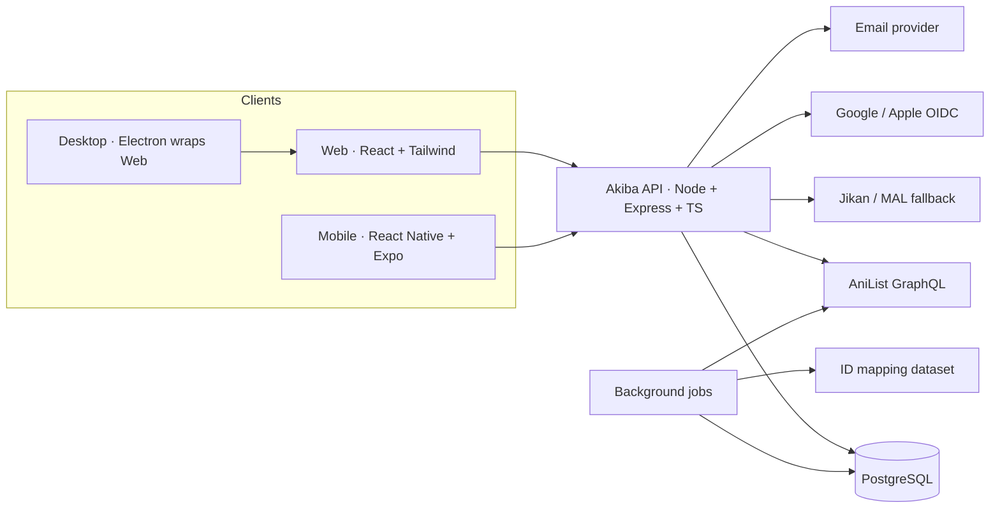

# Architecture

**Version:** 1.0 · **Date:** 2026-11-15 · Deployment topology is deferred (D-24); this describes the logical and code architecture.

## 1. Context


## 2. Monorepo layout (npm/pnpm workspaces)
```
akiba/
  apps/
    api/            Express server, routes, services, jobs entrypoints
    web/            React + Vite + Tailwind
    mobile/         Expo (React Native) app
    desktop/        Electron shell (loads built web app)
  packages/
    shared/         Zod schemas, DTO types, enums, constants
    api-client/     Typed fetch client generated from shared schemas
    ui-tokens/      Design tokens (colors, type scale, spacing) for web + RN
    config/         ESLint, tsconfig, prettier presets
  prisma/           schema.prisma + migrations + seed
  docs/
```
Rule: apps never import from each other; they import `packages/*` only.

## 3. Backend structure (apps/api)
Layers: `routes` (HTTP, validation) → `services` (business rules) → `repositories` (Prisma) and `sources` (external adapters).
```
src/
  server.ts  app.ts
  config/        env parsing (zod), constants
  middleware/    auth, rateLimit, validate, error, requestId
  modules/
    auth/        register, login, oauth, tokens, password reset
    titles/      search, browse, detail, relations, studios, characters
    library/     entries, favorites, ratings, reviews
    tracking/    progress, overrides, runs
    history/     events, timeline
    inbox/       notifications
    share/       share links + public view
    account/     profile, export, delete
  sources/       SourceAdapter interface; anilist/, jikan/
  mapping/       Akiba ID resolver + dataset importer
  jobs/          scheduler, airing-sync, metadata-refresh, mapping-refresh, cleanup
  lib/           logger, errors, pagination, time
```

## 4. Metadata source layer
```ts
interface SourceAdapter {
  name: 'anilist' | 'jikan';
  search(q, filters, page): Promise<SourcePage<SourceTitle>>;
  browse(filters, page): Promise<SourcePage<SourceTitle>>;
  getTitle(externalId): Promise<SourceTitleDetail>;
  getRelations(externalId): Promise<SourceRelation[]>;
  getStudio(externalId) / getCharacter(externalId) / getAiring(externalIds, from, to)
}
```
Flow for a read:
1. Check `title_cache` (fresh? return).
2. Call primary adapter; on success normalise → upsert cache → return.
3. On error/timeout/429: circuit breaker opens; use fallback adapter for reads where its data is sufficient; else serve stale cache with `stale: true`.
4. Every external record is resolved to an **Akiba ID** via `title_external_id` (see §5) *before* being returned.

Resilience: timeouts (5 s), retries with jitter (max 2), per-source rate limiter (token bucket), request coalescing for identical in-flight queries, circuit breaker (open 60 s after 5 failures).

## 5. Akiba ID and mapping
- `title.id` (UUID/ULID) is the Akiba ID; users reference only it.
- `title_external_id(source, external_id, title_id)` is unique per (source, external_id).
- Resolution order: exact external-ID hit → mapping dataset (cross-source IDs) → create new title and register IDs.
- Mapping job (weekly): imports the community dataset, adds missing cross-source rows, flags conflicts in `mapping_conflict` for manual review.
- Manual override table wins over dataset values.
- Duplicate detection: when two titles later share an external ID, merge via an admin script that repoints `library_entry`, `event`, etc. (documented, tested).

## 6. Authentication flow (summary; details in doc 09)
- Access token: JWT, 15 min, signed (EdDSA or HS256 with rotating secret), claims `sub`, `sid`.
- Refresh token: opaque random 256-bit, stored hashed, rotating, family tracking, reuse detection.
- Web: refresh token in `HttpOnly; Secure; SameSite=Lax` cookie; access token in memory. Mobile: refresh token in Expo SecureStore. Desktop: same as web.
- OAuth: authorization-code with PKCE; Apple/Google ID tokens verified server-side against JWKS.

## 7. Background jobs
| Job | Schedule | Purpose |
|---|---|---|
| airing-sync | every 15 min | Fetch upcoming/just-aired episodes for titles present in any Watching entry; upsert `airing_episode` |
| inbox-fanout | after airing-sync | For aired episodes, create `notification` for each user with that title in Watching (unique per user+episode) |
| metadata-refresh | nightly | Refresh cache for popular/library titles; currently airing titles more often |
| mapping-refresh | weekly | Update ID mapping dataset |
| account-cleanup | daily | Hard-delete accounts past grace period; purge expired tokens |
Implementation: in-process scheduler (`node-cron`) in MVP, using Postgres advisory locks to avoid duplicate runs; designed so it can move to a worker process later.

## 8. Client architecture
- **Web:** React + Vite + TypeScript; React Router; TanStack Query for server state; Tailwind with `ui-tokens`; optimistic updates for +1; virtualised lists.
- **Mobile:** Expo + React Native; Expo Router; TanStack Query; shared `api-client` and `shared` types; NativeWind (or token-driven StyleSheet) from `ui-tokens`.
- **Desktop:** Electron loads the built web bundle; `contextIsolation: true`, `nodeIntegration: false`, sandboxed renderer, strict CSP, preload exposes only a minimal API (open external links, window controls). Auto-update added in M7.
- Shared: no business logic duplicated — validation and DTOs in `packages/shared`.

## 9. Cross-cutting concerns
- **Validation:** Zod at every route boundary; shared schemas.
- **Errors:** uniform problem-details JSON (doc 07).
- **Logging:** pino structured logs with request IDs; no PII or tokens in logs.
- **Config:** 12-factor env vars parsed at boot.
- **Observability (MVP):** error logging + aggregate counters from the DB (D-21); no third-party trackers.
- **Time:** all timestamps UTC ISO-8601; user time zone applied at the edge.

## 10. Key trade-offs
| Choice | Gain | Cost / mitigation |
|---|---|---|
| Own Akiba ID layer | Resilient to source change | Mapping complexity → dataset + conflict queue + tests |
| Hand-rolled auth | Full control | Security burden → hardening checklist, review, tests |
| Event log + current state | Real timeline, rewatches | Two representations → services update both in one transaction |
| In-process scheduler | Simple | Single-instance assumption → advisory locks; later worker |
| Electron wraps web | Minimal code | Desktop-specific polish deferred |
