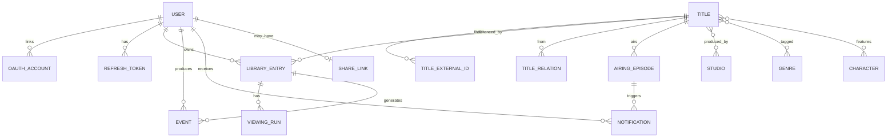

# Data Model

**Version:** 1.0 · **Date:** 2026-11-15 · PostgreSQL ≥ 15, managed by Prisma migrations. IDs are ULIDs/UUIDs. All timestamps are `timestamptz` UTC.

## 1. ER overview

## 2. Tables

### Identity and auth
**user**: `id`, `email` (citext, unique), `email_verified_at`, `password_hash` (nullable for OAuth-only), `display_name`, `title_language` (`romaji|english|native`), `time_zone`, `library_view` (`grid|list`), `alerts_enabled`, `created_at`, `deleted_at` (soft-delete during grace), `purge_after`.
**oauth_account**: `id`, `user_id`, `provider` (`google|apple`), `provider_user_id`, `created_at`; unique (`provider`, `provider_user_id`).
**refresh_token**: `id`, `user_id`, `family_id`, `token_hash` (unique), `expires_at`, `revoked_at`, `replaced_by_id`, `user_agent`, `created_at`.
**one_time_token**: `id`, `user_id`, `purpose` (`verify_email|reset_password`), `token_hash`, `expires_at`, `used_at`.

### Catalog (shared, user-independent)
**title** (the Akiba ID): `id`, `kind` (`tv|movie|ova|ona|special|tv_short|music`), `title_romaji`, `title_english`, `title_native`, `synonyms[]`, `synopsis`, `cover_url`, `banner_url`, `format`, `status` (`finished|releasing|not_yet_released|cancelled|hiatus`), `episodes_total` (source), `duration_min`, `season`, `season_year`, `start_date`, `end_date`, `average_score`, `popularity`, `is_adult`, `franchise_id`, `source_updated_at`, `fetched_at`, `stale`.
**title_external_id**: `id`, `title_id`, `source` (`anilist|mal|kitsu`), `external_id`; unique (`source`,`external_id`).
**title_relation**: `from_title_id`, `to_title_id`, `relation_type` (`prequel|sequel|side_story|spin_off|parent_story|alternative|adaptation|summary|other`); PK of the three.
**franchise**: `id`, `name` (derived via connected components of `title_relation`; recomputed on relation changes).
**studio**: `id`, `name`, `external_ids` (jsonb), `is_animation_studio`.
**title_studio**: (`title_id`, `studio_id`, `is_main`).
**genre**: `id`, `name`; **title_genre**: (`title_id`, `genre_id`). **tag** optional later.
**character**: `id`, `name`, `native_name`, `image_url`, `description`, `external_ids`; **title_character**: (`title_id`, `character_id`, `role`), **voice_actor** + link optional.
**airing_episode**: `id`, `title_id`, `episode_number`, `airs_at`, `source`, `aired_processed_at`; unique (`title_id`,`episode_number`).
**mapping_conflict**: `id`, `source_a`, `id_a`, `source_b`, `id_b`, `reason`, `resolved_at`.
**mapping_override**: manual wins; (`source`, `external_id`, `title_id`).

### User data
**library_entry**: `id`, `user_id`, `title_id`, `status` (`watching|completed|planned|on_hold|dropped`), `progress` (int ≥ 0), `episodes_total_override` (nullable int ≥ 1), `rating` (nullable smallint 1–10), `review` (text, nullable), `is_favorite`, `alerts_enabled` (nullable override of user setting), `notes`, `started_at`, `completed_at`, `added_at`, `updated_at`; **unique (`user_id`,`title_id`)**.
**viewing_run**: `id`, `entry_id`, `run_number` (1,2,…), `started_at`, `finished_at`, `rating` (nullable), `progress_at_end`; unique (`entry_id`,`run_number`). The *current* run is the one with `finished_at IS NULL`. `library_entry.progress` mirrors the current run's progress.
**event** (append-only): `id`, `user_id`, `entry_id`, `title_id`, `run_id` (nullable), `type`, `payload` (jsonb), `occurred_at`, `created_at`.
**notification**: `id`, `user_id`, `kind` (`episode_aired`), `title_id`, `episode_id`, `created_at`, `read_at`; **unique (`user_id`,`episode_id`)**.
**share_link**: `id`, `user_id` (unique), `token_hash` (unique), `scope` (jsonb: statuses[], show_ratings, show_reviews), `created_at`, `revoked_at`.

## 3. Event types and payloads
| `type` | Payload |
|---|---|
| `entry_added` | `{status}` |
| `status_changed` | `{from, to}` |
| `progress_changed` | `{from, to, run}` (one event per change; bulk set records the range) |
| `run_started` | `{run_number}` |
| `run_completed` | `{run_number}` |
| `rated` | `{from, to}` |
| `reviewed` | `{length}` (text lives on the entry; edits tracked by timestamp only) |
| `favorited` / `unfavorited` | `{}` |
| `total_overridden` / `total_override_cleared` | `{from, to}` |
| `entry_removed` | `{}` |
Rules: events are never updated or deleted (except by account purge). A correction is a new event. `entry_id` may point to a removed entry (kept as a tombstone with `status = removed` via soft-delete flag `removed_at`) so history stays intact.

## 4. Invariants and constraints
1. `UNIQUE(user_id, title_id)` on `library_entry` (FR-LIB-006).
2. `progress >= 0`; effective total = `COALESCE(episodes_total_override, title.episodes_total)`; when total is known, `progress <= total` (FR-TRK-007) — enforced in service plus a DB check where total is stored on the entry.
3. At most one open run per entry (partial unique index on `viewing_run(entry_id) WHERE finished_at IS NULL`).
4. `notification` unique per (`user_id`,`episode_id`) → idempotent fan-out.
5. One active share link per user (`share_link.user_id` unique; revoke = set `revoked_at`, regenerate = replace token).
6. Every state change on `library_entry` and its `event` insert happen in **one transaction**.
7. Every `library_entry.title_id` and `event.title_id` reference an Akiba ID — never an external ID.

## 5. Indexes (initial)
`library_entry(user_id, status, updated_at desc)` · `library_entry(user_id, title_id)` unique · `event(user_id, occurred_at desc)` · `event(entry_id, occurred_at)` · `notification(user_id, read_at, created_at desc)` · `title(season_year, season)` · `title using gin(search tsvector)` (local search over cached titles; remote search via source) · `airing_episode(airs_at)` · `title_external_id(source, external_id)` unique.

## 6. Data lifecycle
- **Catalog data** is cached from sources; `fetched_at` drives refresh; never user-owned.
- **Export** (JSON): `{ user, settings, entries[], runs[], events[], favorites[] }` plus CSV of entries. Titles are exported with external IDs so data survives a source/ID change.
- **Deletion:** `deleted_at` set → 14-day grace (Q-09) → hard delete of user, entries, runs, events, notifications, share link, tokens.
- **Retention:** expired tokens purged daily; stale catalog rows kept.

## 7. Migrations
Prisma migrations committed to the repo; destructive migrations require an explicit note in the PR; seed script loads genres and a small development catalog.
