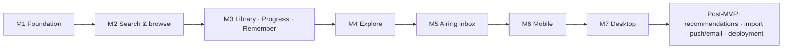

# Roadmap

**Version:** 1.0 · **Date:** 2026-11-15 · Operating model: Claude builds; the product owner reviews and approves at each milestone exit. Durations are deliberately omitted until velocity is observed; milestones are ordered, not dated.

## Overview

**MVP = M1–M6.** M7 (desktop) follows. Deployment is a separate phase after the build (D-24).

## M1 — Foundation
**Goal:** a secure, testable skeleton everything else stands on.
**Scope**
- Monorepo, tooling (TS strict, ESLint, Prettier, Vitest, CI), shared packages
- Express app skeleton: config, logging, error format, validation, rate limiting
- PostgreSQL + Prisma schema for users, tokens, catalog core, mapping, library, events
- Auth: register, login, refresh rotation, logout, email verify, reset, Google/Apple
- Source adapter interface + AniList adapter (read basics) + Jikan stub
- **Akiba ID mapping**: resolver, dataset importer, conflict table, tests
- API client package; empty web shell with auth screens and design tokens
**Exit criteria:** auth security checklist (doc 09) passes; mapping tests pass on a fixture set; CI green; owner reviews the auth code.

## M2 — Search & browse (web)
**Scope:** search, filters, seasonal chart, title detail page, cache + stale/fallback behavior, cover handling, "Shelf" UI shell (nav, cards, grid).
**Exit:** FR-DISC-001…010 pass; NFR-PERF-002 measured; accessibility pass on these screens.

## M3 — Library, progress, remember
**Scope:** add/edit/remove entries, statuses, grid/list views, +1 and set progress, episode-total override, ratings, reviews, favorites, rewatch runs, history timeline, export (JSON/CSV), share link, account settings + deletion.
**Exit:** FR-LIB, FR-TRK, FR-REM, FR-EXPT, FR-SHARE, FR-ACCT pass; IDOR suite green; event-log invariants tested; owner uses it for real tracking.

## M4 — Explore
**Scope:** franchise computation and view, relations on title page, studio pages, character pages, "your status" on franchise entries.
**Exit:** FR-EXP-001…004 pass; franchise grouping verified on a curated set of long franchises.

## M5 — Airing inbox
**Scope:** airing-sync, inbox fan-out, inbox UI (list, unread count, mark read), per-entry/global alert settings, scheduler with advisory locks.
**Exit:** FR-NOTE-001…005 pass; fan-out idempotent under retries; time-zone display correct.

## M6 — Mobile (Expo)
**Scope:** Expo app: auth with secure storage, Discover, Title, Library (grid/list), +1, Inbox, Settings; shared `api-client` and tokens; Google/Apple sign-in on device.
**Exit:** same acceptance criteria as web for included screens; iOS and Android smoke-tested; a11y labels and 44-px targets verified.

## M7 — Desktop (Electron)
**Scope:** Electron shell loading the web build, hardened per doc 09, window/menu basics, external-link handling, auto-update plumbing, packaging for Windows/macOS/Linux.
**Exit:** Electron security checklist passes; packaged builds launch and sign in.

## Post-MVP backlog (ordered)
1. MAL/AniList list import (file-based first) — onboarding.
2. Recommendation engine — separate PRD addendum (Q-05).
3. Push notifications (mobile), email digest.
4. Stats and year-in-review from the event log.
5. Franchise watch-order suggestions; tags and notes.
6. Deployment, hosting, backups, monitoring, privacy policy/terms (own phase).

## Working agreement per milestone
1. Claude proposes the milestone plan (tasks, risks) → owner approves.
2. Build in small commits on the dev branch; tests with each feature.
3. Demo + checklist run → owner sign-off → tag `m<N>`.
4. Docs updated in the same change as any requirement change (SRS IDs stay stable).

## Dependency notes
M2 requires M1 mapping; M3 requires M2 title resolution; M4 requires relations ingested in M2/M3; M5 requires M3 entries; M6 requires stable API from M1–M5; M7 requires the web app.
